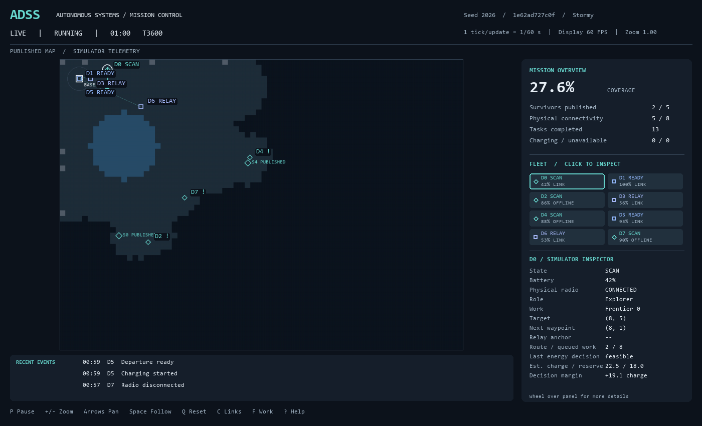
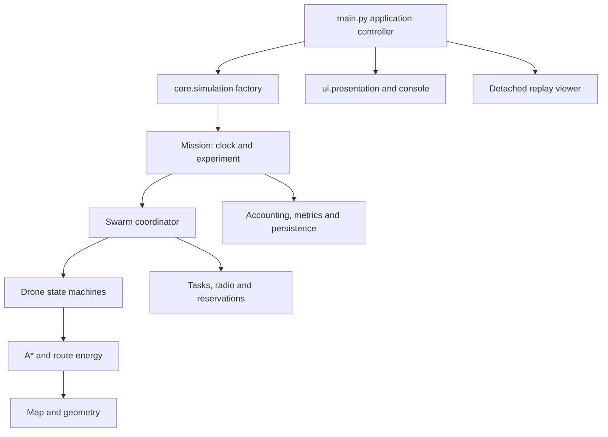

# Autonomous Drone Swarm Simulator (ADSS)

A Python/Pygame multi-agent simulator for exploring path planning, coordinated search, communication constraints and energy-aware autonomy. ADSS pairs an inspectable mission interface with a deterministic, headless simulation engine and regression evidence.



*Real seed-2026 capture at tick 3,600: eight drones, 27.6% published coverage and two of five survivor zones published. Normal operational view; ground-truth mode is off.*

## What it does

Drones search a generated grid containing obstacles, no-fly areas, wind and hazards. A centralized coordinator allocates frontier/sector work and relay roles; individual agents plan routes, sense locally, manage charge and return to base. Disconnected observations stay private until a radio path to base is restored.

The project demonstrates how planning, coordination and simulation engineering interact—and how to test their boundaries. It is an abstract autonomous-systems simulator, **not a flight controller or a physical drone safety model**.

## Key capabilities

- A* with explicit result statuses, corner-valid smoothing and deterministic path variation.
- Centralized Contract-Net-inspired task allocation with authoritative ownership.
- Tick-based reservations and execution-level point-agent priority, wait and bounded backoff.
- Idealized range-based relay connectivity, offline discovery buffering and reconnect synchronization.
- Route-aware abstract-charge admission, return reserve and charging/readiness lifecycle.
- Fixed 60 Hz simulation time, isolated RNG streams and immutable experiment configuration.
- Headless execution, deterministic accounting, CSV output and self-contained sampled detached playback.
- Selected-drone inspection, mission/event views and explicitly labeled ground-truth diagnostics.

## Interface

Click a drone or fleet card to inspect its task, route, connectivity and latest energy decision. The default map shows globally published survivor information; drone positions are **simulator telemetry**, not a modeled telemetry delivery service.

[Interface guide](docs/user_guide.md) · [Published survivor capture](docs/images/survivor.png) · [Detached replay capture](docs/images/replay.png)

## Architecture



Rendering observes authoritative state. The engine can construct and advance a mission without Pygame initialization or UI imports; compatible core drawing helpers still import Pygame. [Architecture and tick ordering](docs/architecture.md)

## Quick start

Tested reference: **CPython 3.13.7 on Windows x64**. From the repository root in PowerShell:

```powershell
python -m venv .venv
.venv\Scripts\Activate.ps1
python -m pip install -r requirements.txt
python main.py
```

The menu offers Start Mission, Demo Mode, Replay Viewer and presentation settings. For environment troubleshooting, a copyable headless example and replay export, see [Getting started](docs/getting_started.md).

| Control | Action |
| --- | --- |
| Click drone / fleet card | Inspect selection |
| `P`, `M` | Pause/resume; return to menu |
| Arrows, wheel / `+` / `-`, `Space`, `Q` | Pan, zoom, follow, reset camera |
| `C`, `T`, `F` | Communication links, routes/trails, frontier/sector work |
| `B`, `J`, `N`, `F1` | Dashboard, events, minimap, help |
| `E`, `L` | Export replay; load latest replay |

## Validation

```powershell
python -m pip install -r requirements-test.txt
python -m validation.sanity
python -m pytest -q -m fast
python -m pytest -q -m "fast or standard"
```

Current inventory: **336 collected tests**. The last full run passed 333 tests; the subsequent menu-only polish passed all 23 UI cases, including three added cases. FAST, STANDARD and HEAVY are distinct tiers; FAST + STANDARD excludes the 10,800-tick smoke.

Evidence includes three-seed per-tick differential comparison, deterministic goldens, failure injection, headless/replay contracts and presentation-independence checks. **GitHub Actions workflows are locally validated; hosted CI and Linux runtime execution remain unverified.** [Validation commands and evidence](docs/validation.md) · [Claims and evidence](docs/claims_and_evidence.md)

## Performance

Profiling identified repeated route-energy geometry as a major cost. A bounded pure-calculation cache preserved exact tested behavior while paired 3,600-tick trials showed mean update reductions of **38.8–49.9%** across three seeds. Maximum latency increased in those trials; no real-time guarantee is claimed. [Measurements, methodology and scaling limits](docs/performance.md)

## Controlled research results

A preregistered study compared radio range and swarm size across eight paired seeds, five conditions and 900 ticks per run. In this short ADSS search window, reducing radio range from 180 to 90 pixels lowered mean published coverage by **7.31 percentage points** (98.75% paired-bootstrap interval: −8.79 to −5.88). Increasing the fleet from eight to sixteen raised coverage by **3.15 points** (2.24 to 3.91), while mean update cost rose from **13.25 to 64.82 ms** in these observational timing trials.

These are model-specific early-search results, not physical-drone or eventual mission-success claims. [Research report](docs/research_report.md) · [Locked protocol](docs/research_protocol.md) · [Raw data and reproduction](research/README.md)

## Technical documentation

| Read | Purpose |
| --- | --- |
| [Architecture](docs/architecture.md) | Ownership, tick sequence, RNG/config, accounting and replay |
| [Algorithms](docs/algorithms.md) | Planning, allocation, collision, communication and energy contracts |
| [Getting started](docs/getting_started.md) / [User guide](docs/user_guide.md) | Run, inspect, record and replay |
| [Validation](docs/validation.md) / [Performance](docs/performance.md) | Reproduce checks and interpret measurements |
| [Limitations](docs/limitations.md) | What the model and evidence do not establish |
| [Engineering evolution](docs/engineering_evolution.md) | Correctness-first development and historical reports |

## Limitations and next work

Coordination is centralized. Collision checks model points with a shared-docking exception and bounded recovery, not finite drone bodies or complete multi-agent path planning. Radio has no packet loss, bandwidth or propagation simulation. Charge is abstract; future traffic/weather can invalidate forecasts. Survivor **discovery** is modeled, survivor **rescue** is not. Replay supports sampled playback, not checkpoints or continuation.

Exact reproducibility is validated for specific configurations/runtime conditions, not proved across platforms. Larger swarms can incur multi-second stalls. [Full limitations](docs/limitations.md)

Steps 1–14 are approved. Step 15, the final planned phase, is approved and closed with its controlled study and reproducible artifacts. No additional roadmap phase has been started.

## License

[MIT](LICENSE).

Publication packaging preserves exact source/research bytes; historical evidence is curated separately. [Evidence provenance](docs/evidence/README.md) · [Release preparation](docs/publication.md)
