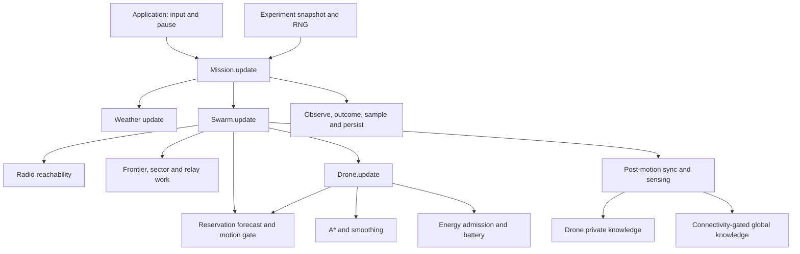

# Architecture and state ownership

ADSS has an authoritative simulation per experiment instance, with support for independent sequential experiments. A centralized swarm coordinator controls assignments; individual drones own their motion/state machines. The UI is an observer and controller, not a source of autonomous decisions.

## Repository map

| Location | Responsibility |
| --- | --- |
| [main.py](../main.py) | Pygame lifecycle, events, pause/menu/live/replay orchestration; compatibility imports |
| [core/simulation.py](../core/simulation.py) | Supported factory; constructs experiment, map, swarm and mission without UI |
| [core/mission.py](../core/mission.py) | Tick clock, weather, mission outcome, metrics sampling and replay recording |
| [core/swarm.py](../core/swarm.py) | Authoritative assignments, frontier/sector negotiation, relay policy and update ordering |
| [core/drone.py](../core/drone.py) | Per-agent state, path execution, battery actions, sensing, private knowledge and recovery |
| [core/map.py](../core/map.py) | Terrain/zone ground truth, published fog, heatmap and survivor publication |
| [core/pathfinding.py](../core/pathfinding.py), [geometry.py](../core/geometry.py) | Grid search, smoothing and shared geometric predicates |
| [core/intelligence.py](../core/intelligence.py) | Frontier structures, reservation forecasts and execution arbitration |
| [core/communication.py](../core/communication.py) | Radio graph, base reachability and synchronization support |
| [core/energy.py](../core/energy.py), [battery.py](../core/battery.py) | Route estimates versus actual abstract-charge accounting |
| [core/experiment.py](../core/experiment.py) | Immutable configuration, identity, RNG ownership and fixed clock |
| [core/accounting.py](../core/accounting.py), [analytics.py](../core/analytics.py) | Event ledger, pure metric queries, observation accounting and CSV |
| [core/replay.py](../core/replay.py), [persistence.py](../core/persistence.py) | Validated sampled snapshots, detached player, unique/atomic files |
| [ui/presentation.py](../ui/presentation.py), [console.py](../ui/console.py), [replay_view.py](../ui/replay_view.py) | Live composition, layout/inspection and detached playback visualization |
| [tests](../tests), [validation](../validation), [benchmarks](../benchmarks) | Regressions, portable gates, profiling and explicit state projections |

Legacy Dashboard/Minimap and core draw helpers remain for compatibility. They do not make headless execution depend on display initialization, but prevent the stronger claim of a Pygame-free core.

## Control and data flow

Arrows represent calls or supplied state, not packets or concurrent workers. Execution is sequential. The renderer reads world, swarm, mission and ledger state; camera, selection, overlay flags and animation RNG belong to presentation.

## One live simulation tick

This order follows `Mission.update` and `Swarm.update`; it is not a proposed pipeline.

1. Activate the experiment configuration. If a detached player is attached, advance that player and return without advancing the live clock.
2. Increment the live tick; set the ledger tick; retain starting positions for distance/contact observation. Advance weather and record any change.
3. Swarm sets energy weather, rebuilds radio reachability and advances contact counters once. Update exploration balance, relay anchors and mesh-repair policy. Broadcast at the configured sync interval.
4. Refresh frontiers and negotiate on their timers; honor forced reassignment requests. Forecast reservations from tick `frame-1`, then begin the current execution gate.
5. Update drones in deterministic reservation priority order with sensing deferred. Each runs its state/energy/failure/planning/motion logic and emits events at mutation sites. Scanning drones with exhausted work complete their task; collect alerts.
6. Refresh radio geometry after motion **without incrementing timeout counters again**. In the same priority order, synchronize buffered discoveries, then sense. Physical connectivity at this boundary gates global publication.
7. Rebuild reservations from the current tick. Check coverage stalls, periodically rebalance sectors, negotiate available frontiers and give eligible idle drones sector fallback work.
8. Mission analytics observes transitions, distances and contacts. Evaluate success, freeze a final summary on first completion, and sample metrics. Write CSV every 60 ticks or on completion; record replay at its configured sample interval.

Allocation after movement can set up the next tick's work. Sensing is not interleaved with each drone's movement in the normal swarm update, avoiding stale pre-motion connectivity delivery.

## Time, configuration and RNG

One update advances **1/60 simulation second**. The controller chooses when to call it; pause suppresses updates. Rendering FPS affects wall-clock throughput, not the meaning of a tick. Wall time remains appropriate for profiling and display FPS.

`ExperimentConfig.capture()` snapshots simulation settings. Its canonical JSON includes schema and tick rate; immutable nested settings are active during factory creation and Mission updates. Colors/fonts, window/FPS settings, output directories and the default seed setting remain outside that snapshot. The resolved seed is stored separately in `Experiment` and included in its identity. Low-level component calls outside Mission should use `with mission.experiment.activate():`; otherwise legacy dynamic defaults apply.

Experiment identity is SHA-256 of canonical seed, RNG-version and configuration data. It is **not a hash of source code or all Python state**. The world stream preserves direct seed initialization; other named/agent streams derive seeds using labeled SHA-256 material. Environment, failures and agent behavior are isolated from presentation randomness. Stream separation is deterministic ownership, not a statistical-independence proof. Some seeded planning helpers are pure deterministic functions rather than mutable stream consumers.

## Metrics, outcome and persistence

The per-swarm version-1 accounting ledger stores immutable, detached event records with tick, lifetime sequence, type, actor, subject, reason and canonical payload. Same-tick order is emission order. Only the latest 4,096 records are retained by default; lifetime counts and a chained event hash survive eviction. Queries do not consume events. Idempotence belongs to mutation sites, not blanket suppression of repeated event types.

Analytics combines event counts, sampled state and explicitly named diagnostics. Local survivor observations, unique local discoveries and globally published survivors differ. Rescue is unsupported (`None`); proximity episodes are not actual point contacts. Battery quantity is abstract charge; average battery is a percentage. Coverage means revealed **non-obstacle cells**, including no-fly cells in its denominator—not percentage of traversable flight routes.

Success retains the approved policy: **98% coverage OR every survivor zone globally published when the zone list is nonempty**. It does not require rescue, every drone home, or perfect connectivity. No terminal-failure/time-limit policy is invented. Duration and final summary freeze once; explicit benchmark updates may continue, with live metrics distinguished from the frozen summary.

Replay version 2 embeds experiment/config/world plus sampled public/private state, with optional versioned accounting and energy extensions. It does not restore behaviorally complete RNG/controller state and cannot continue a run. A player advances one playhead tick per update, holds the latest sample at or before that tick, supports seeking and stops at its end. Loading a different seed uses the stored world in a detached viewer. The live mission is not overwritten or automatically resumed.

Replay writes and CSV rewrites use unique names and atomic persistence helpers; incompatible, malformed or incomplete payloads are rejected. Sampling and retention limits mean replay is neither every-tick recording nor an event-sourced reconstruction. See [replay tests](../tests/replay_tests.py), [accounting tests](../tests/accounting_tests.py) and [limitations](limitations.md).
