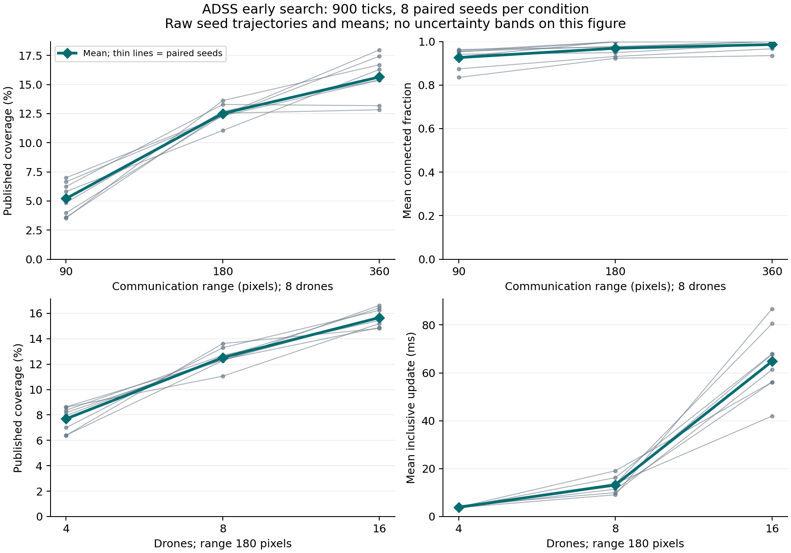
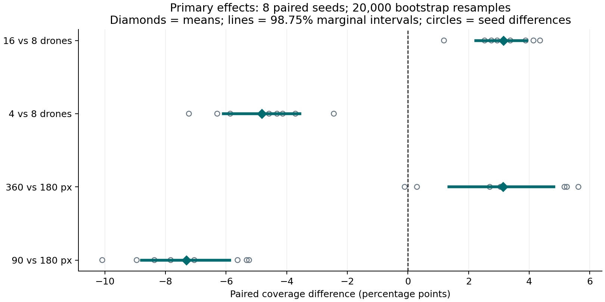

# Controlled early-search experiments in ADSS

## 1. Abstract

Forty paired headless runs across eight new seeds compared radio ranges of 90/180/360 pixels and swarm sizes of 4/8/16 for 900 ticks (15 simulated seconds). The approved simulator policy remained unchanged. 90 versus 180 px: paired mean coverage difference -7.309 percentage points, adjusted marginal interval [-8.792, -5.879]; supported difference. 360 versus 180 px: paired mean coverage difference +3.131 percentage points, adjusted marginal interval [+1.354, +4.811]; supported difference. 4 versus 8 drones: paired mean coverage difference -4.823 percentage points, adjusted marginal interval [-6.096, -3.564]; supported difference. 16 versus 8 drones: paired mean coverage difference +3.146 percentage points, adjusted marginal interval [+2.235, +3.912]; supported difference. Mean effects and paired bootstrap uncertainty are reported alongside raw seed values; timing and mission outcomes remain separate. Results are confined to this early-search model and convenience seed set.

## 2. Research questions

RQ-C: How does configured radio range affect early published coverage and related connectivity/publication outcomes?

RQ-S: How does drone count affect early published coverage, task coordination and computational cost?

Energy-policy ablation and a separate terrain-density/deconfliction experiment were deferred. There is no clean existing energy control, and disabling safety would not isolate a defensible mechanism.

## 3. Simulator scope

Reference: approved Step 14 implementation, source identity recorded in the manifest. Centralized Contract-Net-inspired allocation; point-agent motion/arbitration with shared docking; ideal symmetric radio graph; local/private versus globally published knowledge; route-aware abstract energy; fixed 60 Hz simulation time; deterministic accounting; detached sampled recording. No source policy changed.

## 4. Experimental design

Two paired, three-level factors share one reference condition. Only one existing configuration parameter changes per contrast. The communication intervention affects reachability and the existing communication-aware autonomy policies together. The swarm-size intervention changes agent supply, derived relay demand, contention and failure exposure. These are total configured-system effects, not isolated transport or per-agent-speed effects.

## 5. Hypotheses

Before pilot/main results, the protocol specified zero paired mean coverage difference as H0 for four contrasts: range 90/360 versus 180 pixels and count 4/16 versus 8. H1 was nonzero difference. Engineering expectations were more private/disconnected exposure at short range and possible progress/overhead tradeoffs with more agents; these were explicitly not directional confirmatory hypotheses.

## 6. Conditions

| Condition | Drones | Radio range (px) |
| --- | --- | --- |
| range_90 | 8 | 90 |
| reference | 8 | 180 |
| range_360 | 8 | 360 |
| swarm_4 | 4 | 180 |
| swarm_16 | 16 | 180 |

The 72×52 map, 14-pixel cells, default energy/relay/allocation/collision settings, enabled failures and 900-tick weather interval were held fixed. The full immutable configuration for every condition is embedded, not reconstructed from this table. Weather starts Clear and first changes at tick 900; this horizon therefore does not measure sustained adverse-weather behavior.

## 7. Seed strategy

Main seeds 41001–41008 were fixed before results. All conditions run for each seed, with rotated deterministic condition order. The shared reference is one run per seed, not two independent observations. Pilot seeds 49001/49002 are excluded. These eight consecutive seeds are a convenience scenario set; population inference beyond them is limited.

## 8. Metrics

Primary: final globally published coverage (% of non-obstacle map cells). Secondary: survivor publication, connectivity exposure, pending knowledge, uploads, task/energy/safety accounting and latency. Full metrics are retained, but the existing arbitrary mission-efficiency composite is not analyzed.

Pending-map exposure counts duplicate per-agent buffers; new pending entries can recur after synchronization. Connectivity uses all deployed drones, including ineligible/unavailable radios. Survivor publication delay starts at the first local observation across drones; an unpublished zone at horizon is right-censored. No rescue metric is invented.

## 9. Statistical methods

Per condition, report n, mean, median, sample SD and quartiles; per contrast, paired differences in natural units. Primary effects are percentage-point differences. A NumPy PCG64 stream seeded 1502026 draws 20,000 paired seed-block bootstrap samples. Report 95% percentile intervals and 98.75% Bonferroni-adjusted marginal intervals for four primary contrasts. No p-values or normality assumption are used.

The resampling unit is the seed, not correlated ticks, agents or survivor observations. The percentile construction follows the standard paired-resampling method described in the [SciPy bootstrap documentation](https://docs.scipy.org/doc/scipy/reference/generated/scipy.stats.bootstrap.html); the implementation uses NumPy directly, not SciPy. Small-sample interval coverage is approximate. Nominal familywise adjustment is not a proof of actual 95% simultaneous coverage for eight convenience seeds.

## 10. Reproducibility

The v1 preregistration, pilot summary, main hash lock, configurations, raw JSON/checksums, original CSV, final covered-state hashes and analysis are preserved. Default policy remains frozen; the runner only controls construction/stepping, records observations and transparently times the existing CSV call. No rendering or profiling occurs in timing runs. The reference repeat matches all 24 non-timing result fields, including the covered state/RNG/accounting hashes. Independently rerun analysis regenerates byte-identical tables and figures. A relative-input-path provenance error in the first analysis attempt was corrected with a tooling regression; no measurements or statistical calculations changed.

## 11. Results

All 40 locked main runs completed; no exclusions or failed main runs. Same-seed worlds match across conditions. Pilot runs are separate. 0/40 missions reached success; 0 field-contact events and 0 stranded transitions were recorded. These short-window counts are not universal safety evidence.

| Condition | n | Coverage mean % (SD) | Survivors mean | Connected mean % | Task completions mean | Pending map exposure mean |
| --- | --- | --- | --- | --- | --- | --- |
| 90 px / 8 drones | 8 | 5.21 (1.40) | 0.000 | 92.63 | 3.88 | 19.76 |
| 180 px / 8 drones | 8 | 12.51 (0.77) | 0.750 | 96.91 | 6.62 | 4.15 |
| 360 px / 8 drones | 8 | 15.65 (1.86) | 1.000 | 98.64 | 5.88 | 0.00 |
| 180 px / 4 drones | 8 | 7.69 (0.95) | 0.250 | 98.02 | 3.62 | 0.04 |
| 180 px / 16 drones | 8 | 15.66 (0.70) | 0.875 | 94.18 | 7.88 | 28.84 |

| Contrast versus reference | Mean difference (pp) | 95% CI | 98.75% CI | Primary classification |
| --- | --- | --- | --- | --- |
| range_90 | -7.309 | [-8.471, -6.162] | [-8.792, -5.879] | SUPPORTED difference |
| range_360 | +3.131 | [+1.729, +4.469] | [+1.354, +4.811] | SUPPORTED difference |
| swarm_4 | -4.823 | [-5.837, -3.824] | [-6.096, -3.564] | SUPPORTED difference |
| swarm_16 | +3.146 | [+2.443, +3.771] | [+2.235, +3.912] | SUPPORTED difference |





## 12. RQ-C: communication range

90 versus 180 px: paired mean coverage difference -7.309 percentage points, adjusted marginal interval [-8.792, -5.879]; supported difference. 360 versus 180 px: paired mean coverage difference +3.131 percentage points, adjusted marginal interval [+1.354, +4.811]; supported difference. Mean connectivity exposures for 90/180/360 px are 92.63%, 96.91%, 98.64%. Interpret these as outcomes of range-aware autonomy, not radio range alone with trajectories held fixed. Pending buffers and synchronization counts are available per seed. Across all conditions, 24 distinct run/zone first-local observations were recorded, 1 still unpublished at the horizon. Delay tables retain censoring; no uncensored pooled delay mean is used to claim publication improvement.

| Condition | Disconnected agent-ticks mean | Pending map exposure mean | Map uploads mean | Offline survivor reports mean | Published by horizon (runs/8) | Reached 10% coverage (runs/8) |
| --- | --- | --- | --- | --- | --- | --- |
| 90 px / 8 drones | 530.6 | 19.76 | 19.25 | 0.000 | 0 | 0 |
| 180 px / 8 drones | 222.8 | 4.15 | 11.62 | 0.125 | 5 | 8 |
| 360 px / 8 drones | 98.2 | 0.00 | 0.00 | 0.000 | 7 | 8 |
| 180 px / 4 drones | 71.4 | 0.04 | 0.50 | 0.000 | 2 | 0 |
| 180 px / 16 drones | 837.8 | 28.84 | 75.12 | 0.125 | 6 | 8 |

Pending-map exposure is the time-average sum of per-agent buffer sizes; uploads count per-agent synchronized cells, not globally unique cells. Attainment denominators retain every run. No radio-range effect on survivor-publication delay is established: most observed reports publish immediately, and the short-range condition has no local survivor observations in this sample.

## 13. RQ-S: swarm size

4 versus 8 drones: paired mean coverage difference -4.823 percentage points, adjusted marginal interval [-6.096, -3.564]; supported difference. 16 versus 8 drones: paired mean coverage difference +3.146 percentage points, adjusted marginal interval [+2.235, +3.912]; supported difference.

| Condition | Awards | Completions | Cancellations | Waits | Backoffs | Path searches | Energy checks |
| --- | --- | --- | --- | --- | --- | --- | --- |
| 90 px / 8 drones | 10.00 | 3.88 | 1.38 | 614.25 | 0.12 | 1636.38 | 254268.38 |
| 180 px / 8 drones | 16.12 | 6.62 | 2.88 | 1348.62 | 0.88 | 1831.75 | 24418.75 |
| 360 px / 8 drones | 14.88 | 5.88 | 1.38 | 1495.88 | 0.88 | 1444.12 | 4004.12 |
| 180 px / 4 drones | 9.12 | 3.62 | 1.62 | 144.75 | 0.25 | 585.75 | 2410.75 |
| 180 px / 16 drones | 19.88 | 7.88 | 2.50 | 2183.00 | 1.38 | 4332.25 | 307933.00 |

Waits are rejected movement events, not physical contacts. Added agents also change derived relay roles and failure opportunities. Effects are for the whole configured swarm, not per-agent productivity.

Coordination table entries are per-run means across eight paired seeds, not pooled counts.

## 14. Deferred energy comparison

No third experiment was run. A credible energy-policy baseline would require separately reviewed intervention support. The established avoided-stranding engineering fixture is not reused as confirmatory research data.

## 15. Trade-offs

The paired tables show separate mission, coordination and computational outcomes; none is collapsed into a score. A larger available fleet can increase early coverage while increasing waits, searches and cost. Short radio range also changes the region and work the policy accepts. These adaptive responses prevent a simple interpretation that more connectivity always means more exploration.

## 16. Negative and null findings

Survivor publication is sparse (per-run counts and null/censored times are retained). 0/40 runs reach mission success at the fixed horizon. Absence of long-run successes/stranding within 15 seconds cannot establish eventual completion or energy safety. Primary intervals that include zero indicate insufficient evidence of a difference, not equivalence. Secondary results do not acquire confirmatory status because they look favorable.

## 17. Computational performance

| Condition | Mean update ms | Mean p50 | Mean p95 | Mean p99 | Worst max | Mean excluding CSV ms |
| --- | --- | --- | --- | --- | --- | --- |
| 90 px / 8 drones | 36.628 | 32.653 | 48.990 | 84.018 | 2439.765 | 36.438 |
| 180 px / 8 drones | 13.254 | 7.428 | 26.648 | 68.001 | 602.820 | 13.055 |
| 360 px / 8 drones | 8.786 | 6.892 | 14.452 | 33.085 | 522.805 | 8.601 |
| 180 px / 4 drones | 3.886 | 3.280 | 5.991 | 17.017 | 70.827 | 3.694 |
| 180 px / 16 drones | 64.819 | 42.838 | 132.864 | 366.494 | 3736.303 | 64.618 |

Main collection spent 917.1 seconds in simulation updates; pilot projected 637.2 seconds. Per-seed raw latency arrays preserve variation. The reference repeat matches all covered non-timing fields, while its timing differs; see the reproducibility artifact. This is not a real-time guarantee or a profiler-derived attribution of runtime to one subsystem.

Across main runs, measured CSV calls total 6.965 s within updates; post-update observation totals 4.862 s outside them. Analysis and plotting took 3.43 s separately. Reference seed 41001 mean update time was 9.977 ms originally and 8.274 ms on repeat; maxima were 472.825 and 649.005 ms. Exact behavioral equality with different timing demonstrates host/run variability, not an optimization. Table p50/p95/p99 values are means of the eight run-level quantiles; worst max is the largest observed tick. Individual values, SD and quartiles remain in the processed tables. No direct comparison to historical uninstrumented optimization timings is made.

Inclusive Mission.update time includes in-memory replay recording and normal CSV persistence. A lightweight wrapper separately measures CSV calls; subtracting that component is not pure CPU time. Construction, research observation/output, analysis and plotting are outside the update timer. No condition comparison changes persistence cadence to gain speed. The protocol mentioned timing replay export; the frozen runner did not request an end-of-run export, so that measurement is unavailable. This is a recording limitation, not a changed intervention or endpoint.

## 18. Threats to validity

**Internal:** hashes and world pairing protect intervention isolation, not absence of simulator bugs. Allocation/relay adaptation mediates range effects. Count changes failure exposure. One sequential pass can confound condition timing with host state despite rotated order. Query/wrapper equivalence has a focused fixture, not a proof over every execution.

**Construct:** coverage is published non-obstacle-cell visibility, including no-fly cells in its denominator. It is not terrain traversability, victim rescue or information quality. Connectivity is ideal reachability, not usable RF throughput. Charge, radio and point collisions are abstractions.

**External:** eight generated worlds, one map geometry/settings family and 15 simulated seconds do not represent physical aircraft, realistic RF, deployment hardware, decentralized coordination, larger maps or long-run mission success. There are no human/operator interventions, but built-in automatic recovery remains policy.

**Statistical conclusion:** n=8 limits interval accuracy and power; discrete survivor counts can have floor effects. Bootstrap resampling treats observed seed blocks as exchangeable despite a deterministic convenience sample. Secondary intervals are not multiplicity-controlled. Shared reference correlations and paired seed dependence are retained rather than counted as extra n. Timing includes host noise and is not normally distributed or independently replicated at each tick.

## 19. Simulator limitations

No physical flight dynamics, finite-body clearance, realistic RF, survivor rescue or checkpoint continuation. Collision backoff can block; energy forecasts cannot predict every future traffic/weather change. Zero adverse events over this short horizon would not establish their impossibility. See [model limitations](limitations.md).

## 20. Discussion

The controlled interventions identify sensitivity of the approved system in a short initial-search window. They do not compare new algorithms or demonstrate superiority over another simulator. Relative coverage effects are useful for choosing hypotheses for a future separately approved study, but cannot determine an optimal fleet/radio specification for physical aircraft. A longer horizon, broader independent world sample and explicit timing replication would strengthen external/statistical validity.

## 21. Conclusions and claim classification

| Classification | Conclusion |
| --- | --- |
| SUPPORTED difference | range_90: paired mean coverage difference -7.309 percentage points, adjusted marginal interval [-8.792, -5.879]; supported difference. |
| SUPPORTED difference | range_360: paired mean coverage difference +3.131 percentage points, adjusted marginal interval [+1.354, +4.811]; supported difference. |
| SUPPORTED difference | swarm_4: paired mean coverage difference -4.823 percentage points, adjusted marginal interval [-6.096, -3.564]; supported difference. |
| SUPPORTED difference | swarm_16: paired mean coverage difference +3.146 percentage points, adjusted marginal interval [+2.235, +3.912]; supported difference. |
| MIXED / descriptive | Mission progress and computational/coordination costs move differently; see raw paired observations. |
| UNSUPPORTED | This 15-second study does not establish eventual mission success, physical safety or long-run energy robustness. |
| EXPLORATORY | Secondary publication, connectivity and buffering mechanisms are descriptive; no multiplicity-controlled secondary claims. |

All conclusions are restricted to the tested ADSS configurations. No new phase or feature development is implied.

## 22. Reproduction commands

From the root with the pinned simulation environment:

```powershell
python experiments/run_step15.py --manifest research/manifests/main.json --output research/raw/reproduction
python experiments/run_step15.py --manifest research/manifests/main.json --output research/raw/repeat --only reference_seed41001
```

For analysis, use the separate pinned NumPy/Matplotlib environment:

```powershell
python research/analysis/analyze.py --manifest research/manifests/main.json --raw research/raw/main --output research/processed --figures research/figures
```

See [research artifact guide](../research/README.md), [protocol](research_protocol.md) and [Step 15 closure](step15_engineering_report.md). Existing completed artifacts are verified and skipped; fresh reproduction uses a new destination. Do not overwrite raw results or regenerate a favorable seed set.
