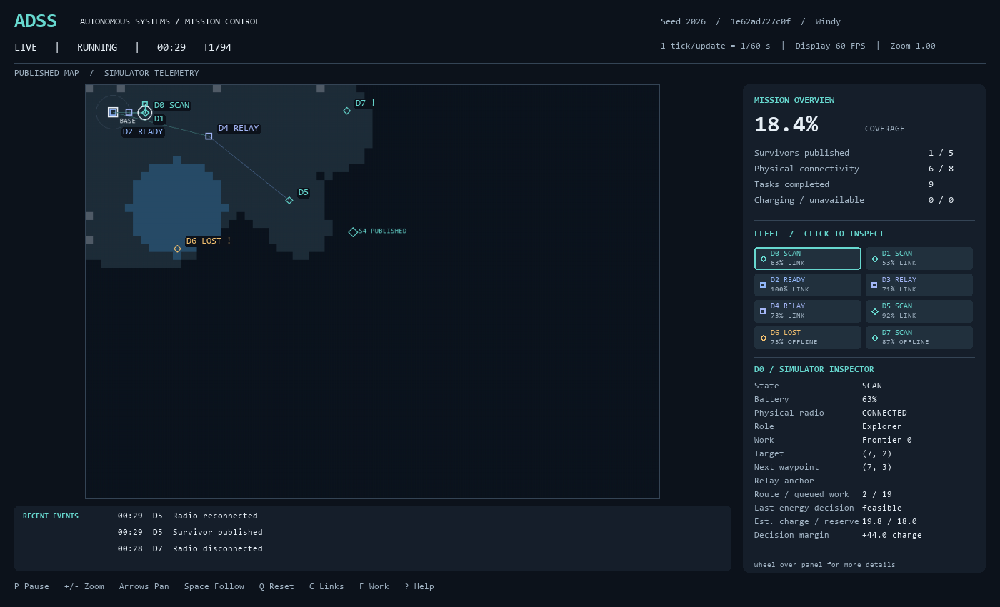
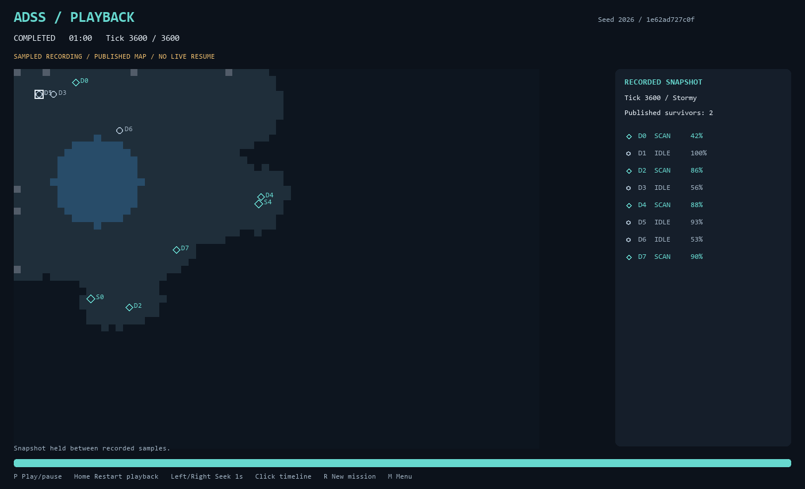

# User guide

## Start and read a mission

Choose **Start Mission** for normal settings or **Demo Mode** for the existing compact/cinematic scenario. Demo is a separate configuration, not benchmark evidence equivalent to normal missions. Menu shortcuts are 1–5, arrows and Enter/Space; mouse selection also works.

The header distinguishes LIVE from detached playback and shows simulation tick/time, seed and weather. Mission overview reports published coverage, published survivors, physical connectivity and completed work. Coverage counts non-obstacle cells; survivor publication is discovery, not rescue.

Click a drone or fleet card to select it; right-click clears selection. The inspector shows state/role, battery, radio, task/target, next waypoint and latest recorded energy decision. It does not rerun energy policy to display a value. Scroll over the inspector for additional details. Fleet cards permit selection when drones overlap at the shared dock.

Labels and shapes distinguish SCAN, RETURN, CHARGE, LOST, FAILED and STRANDED; READY and RELAY are derived presentation labels. Color is supplemented by text/glyphs, but arbitrary display/DPI and color-vision accessibility have not been certified.

## Knowledge and diagnostics

Normal survivor markers require **global publication**, even where terrain is already revealed. Private/pending counts are diagnostics, not survivor coordinates. Offline drone positions and state remain visible as **simulator instrumentation**; this does not model delivery of telemetry packets.

`G` explicitly toggles **GROUND TRUTH / DEBUG**. This omniscient view is for diagnosis and should be disclosed in demonstrations. The recent-event feed filters existing ledger events; it is neither a new event source nor a complete journal browser.

## Navigation and controls

| Control | Action |
| --- | --- |
| `P` | Pause/resume updates |
| `Esc` | Pause from running; otherwise return to menu (quit from menu) |
| `M`, `R` | Menu; construct a new mission |
| Arrow keys / held WASD | Pan camera; some letter keys also toggle overlays on keydown |
| Wheel over map / `+` / `-` | Zoom |
| Wheel over inspector | Scroll selected detail |
| `Space`, `Q` | Cycle follow camera; reset camera |
| Click minimap | Reposition camera |
| `[`, `]` | Fleet pages |
| `C`, `T`, `F` | Communication tree; all routes/trails; frontiers/sectors |
| `S`, `H`, `V`, `D` | Sensors; published heatmap; reservation occupancy; decision labels |
| `B`, `J`, `N` | Dashboard; recent events; navigation minimap |
| `G`, `I`, `F1` / `?` | Ground truth; experiment identity message; help |
| `E`, `L` | Export replay; load latest replay |
| `Y` | Explicit operator recovery of stranded drones to base, disabled in replay |

Operator recovery moves **drones**, not survivors. It is an intervention, not proof of autonomous recovery. Prefer arrows for panning without letter-key overlay interactions. Optional dense decision labels can overlap; disabling them leaves the inspector available.

## Settings and window sizes

Settings control presentation toggles, not an experiment editor. The displayed order and keyboard handler share one definition. Use arrows and Enter/Space; numeric shortcuts cover the first nine entries. Zoom keys remain available.

The window is resizable with a 1100×760 minimum. Visual QA covers 1100×760, 1400×850 and 1920×1080. Camera/selection/layout changes leave authoritative state unchanged under tested conditions; that is not certification for every window manager or DPI setting.

## Detached replay

Replay Viewer loads the latest saved file. Playback clearly labels its stored experiment and completion state. `P` pauses; Left/Right seek by 60 timeline ticks, Home returns to the first tick, and the timeline can be clicked. The display holds sampled states between records rather than inventing intermediate agent motion.

At the end, playback stops; it cannot automatically resume live simulation. Seeking uses the existing detached player API and never applies replay state into live objects. Start a new mission explicitly to simulate again. Replay is not checkpoint continuation.

The images are unedited approved captures; see [image provenance](images/README.md).
